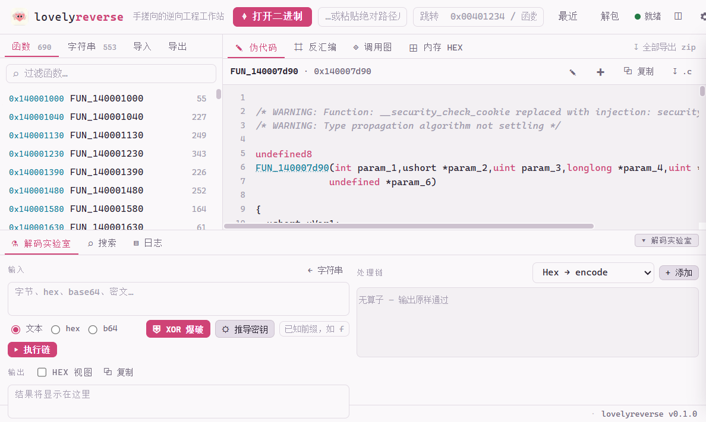
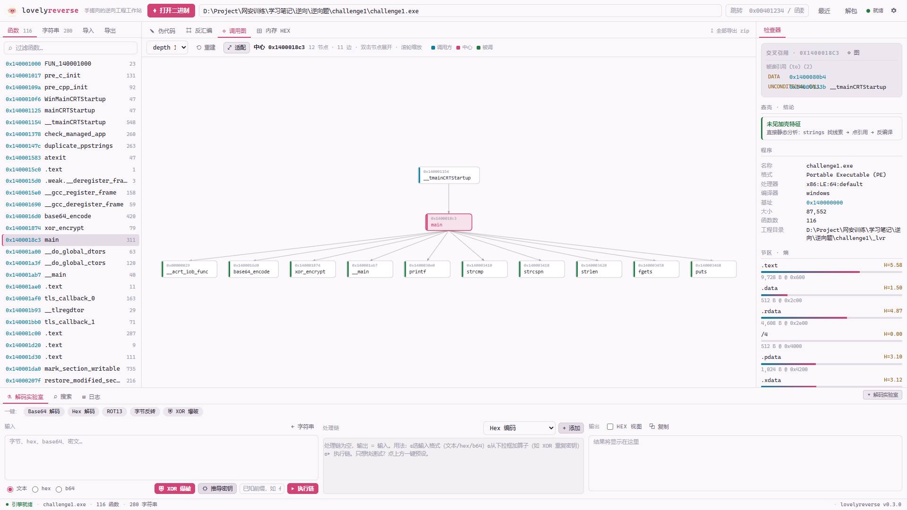
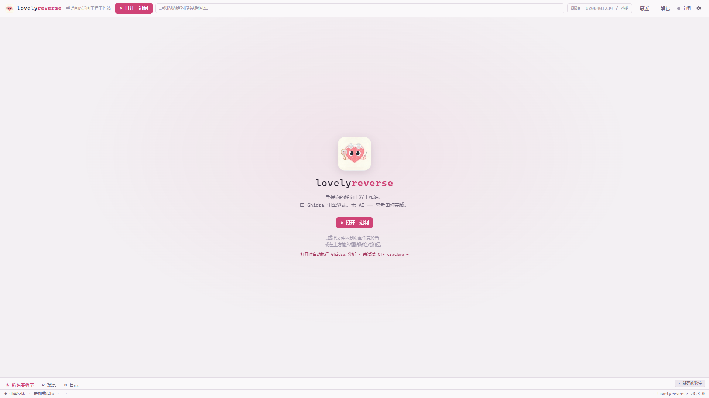
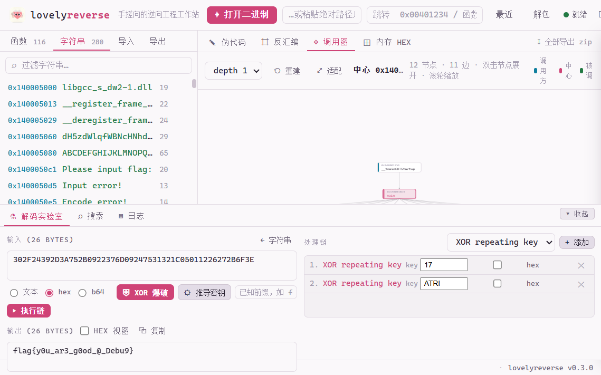
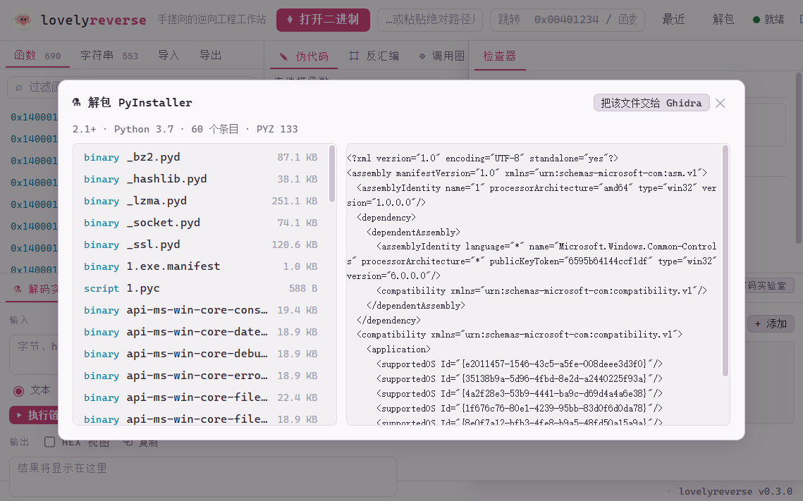

# lovelyreverse

> **手搓向的逆向工程工作站** — PyGhidra 驱动 Ghidra 引擎，界面专为手工分析 / CTF 解题设计。
> **No AI inside.** 这个工具不替你思考——它让你思考得更快。
>
> A hands-on reverse-engineering workstation powered by the Ghidra engine, built for manual analysis and CTF work. No AI — the tool doesn't think for you, it makes you think faster.

<p align="center">
  
  <br/>
  <em>Decompile view — clickable identifiers, syntax highlighting, live entropy bars</em>
</p>

<p align="center">
  
  <br/>
  <em>Call graph — Ghidra-style hierarchical layout: callers above, callees below, double-click to expand</em>
</p>

## 这是什么

打开一个二进制，Ghidra 引擎自动分析；然后在浏览器里以 IDE 三栏布局完成整个手搓流程：
函数列表 → 伪代码 → 汇编 → 内存十六进制 → 交叉引用 → 调用图 → 解码实验室 → 解题。

名字里的 ♥（lovely + reverse）就是这个项目的态度：逆向是手艺活，工具应该像一把顺手的刻刀，而不是一个代劳的黑盒。

<p align="center">
  
</p>

## 功能

### 分析核心（Ghidra 引擎，进程内直驱）

| 面板 | 能力 |
|---|---|
| **functions** | 全量函数列表，实时过滤，滚动加载；点击即反编译 |
| **✎ decompile** | C 伪代码 + 自研语法高亮；**代码里的函数名/地址可点击跳转**；✎ 重命名 / ✚ 备注 / 复制 / 下载 `.c` |
| **⌗ disassembly** | 汇编清单（地址/字节/助记符），call 目标可点击跟进 |
| **◈ call graph** | **函数调用图**（Ghidra 式层次布局）：caller 在上 / callee 在下，层次分层 + 重心排序减少交叉；实线箭头表示调用方向、虚线表示回边；**双击节点增量展开**，滚轮缩放、拖拽平移 |
| **⊞ memory hex** | 按内存块原始读取，翻页/跳偏移；一键送入解码实验室 |
| **strings** | Ghidra 识别的字符串，一键送入解码实验室 |
| **imports / exports** | 导入函数（含所属库）与导出入口 |
| **inspector** | 程序信息（格式/架构/编译器/基址）、节区熵值条（>7.2 提示 likely packed）、**Overlay 附加数据检测**、交叉引用、加密常量命中、**PyInstaller 一键解包** |

### CTF 特化（本工具的存在意义）

- **加密常量识别**（FindCrypt 精髓）：内置 40+ 签名——AES S-box/Te0、SM4 S-box/FK、SM3 IV、MD5/SHA-1/SHA-256/SHA-512 IV 与 K 表、Blowfish P 数组、Camellia σ、TEA/XTEA δ、ChaCha σ、Base64/32/Uuencode 字母表、CRC 表、ECC 域素数（程序化生成，零抄写错误）。自动展开大小端双变体，命中自动归属到函数。打开一个带 AES 的 crackme，`.rdata` 里的 S-box 直接标出来。
- **解码实验室**（CyberChef 精髓）：28 种操作**链式**叠加（hex/base64/base32/ascii85/URL/ROT-n/ROT47/XOR/RC4/位反转/C 转义/gzip/zlib/raw inflate/MD5/SHA-1/SHA-256…），输入支持 text/hex/b64 三种模式。
- **XOR 工具箱**：
  - 单字节爆破 + 可打印评分排序（`⛨ xor brute`）
  - **已知明文推密钥**（`⛭ derive key`）：输入 `flag{` 前缀，直接算出循环 XOR 密钥（含周期一致性检查）
- **Overlay / 熵分析**（binwalk 精髓）：纯 Python 解析 PE/ELF 节表，`end_of_raw` 之后的数据判为 overlay；逐节香农熵 + 全文件熵剖面，加壳一眼可见。
- **PyInstaller 一键解包**（pyinstxtractor 内置化）：识别 CArchive cookie，解出全部条目与 PYZ 模块，pyc 头自动补齐（PEP 552），入口脚本置顶，预览后可直接送 Ghidra 分析。
- **批量反编译**：一键把全部函数导出为 zip（每个函数一个 `.c`）。

<p align="center">
  
  <br/>
  <em>Decoder lab — chained ops: hex ciphertext XOR 0x5A → flag, in the default light theme</em>
</p>

### 工作站体验

- **中文界面**：默认中文，右上角 ⚙ 设置一键切 English；**浅色主题默认**，石墨玫瑰暗色保留，偏好本地记忆。
- **函数重命名 + 备注**：伪代码里改名即时同步到函数列表与调用图，备注跟随函数持久化。
- **最近打开**：工具栏「最近」下拉，历史样本一键重开。
- **一键送解码实验室**：strings 行 ⚗、hex 面板发送按钮，密文零搬运。
- **快捷键**：`g` 跳转、`/` 过滤、`1-4` 切左侧页签、`n` 重命名、`m` 备注、`?` 帮助、`esc` 关弹窗。
- **窄屏自适应**：小窗口下检查器收进侧滑抽屉，三栏不挤爆。

### 实战验证

用本工具实测题库（2026-11-11，10 个样本全链路：打开 → 分析 → 反编译 → 调用图 → 常量 / 熵）：

| 样本 | 特点 | 结果 |
|---|---|---|
| `c_sm4.exe` | 国密 SM4 | **SM4 S-box 命中**，一眼定位加密函数 |
| `crackme_easy.exe` | 经典 crackme | 86 函数，反编译 / 调用图 ✓ |
| `Her.exe` | MSVC 常规题 | 262 函数 ✓ |
| `flower.exe` | 花指令混淆 | 685 函数，Base64 / Uuencode 表命中 |
| `Ferris's Secret Scuttle.exe` | **加壳** Rust 题 | 熵 **7.93 → likely packed**，仅 4 函数（壳代码本就不可分析） |
| `Ferris_unpacked_OEP.exe` | 同题解壳 dump | 熵 6.25、**2727 函数**——加壳前后一眼可辨 |
| `NotNormalExe.exe` | 7.8 MB 怪样本 | 817 函数 ✓，CRC 表 ×4 命中 |
| `MazE` / `wtf` | **ELF x86-64** | ELF 全链路 ✓，wtf 命中 TEA δ + Base64 |
| `opcode.bin` | 0 字节坏文件 | 优雅报错不崩，且不毒化引擎（回归测试固化） |

- 学习笔记中的 `ez_debug` 密文，解码链 `[xor ATRI] → [xor 17]` 直接解出 `flag{y0u_ar3_g0od_@_Debu9}`
- gcc 编译的 crypto_demo 常量扫描 **5/5 命中、零误报**，TEA δ 正确归属 `tea_encrypt`（引擎测试固化）
- 题库 `pyre.exe`（PyInstaller 打包题）：overlay 自动识别，解包 **60 个条目 · PYZ 133 模块**，入口脚本 `1.pyc` pyc magic 修复后可直接预览 / 送 Ghidra

<p align="center">
  
</p>

## 快速开始

### 前置要求

- **Python ≥ 3.10**（3.13 实测通过）
- **Java JDK 21+**（Ghidra 12.x 要求；Java 25 实测通过）
- **Ghidra 11.3+ 或 12.x**（[下载](https://github.com/NationalSecurityAgency/ghidra/releases)）
- Windows 优先（Linux/macOS 理论可用，未系统测试）

### 安装

**方式一：从 GitHub Release 安装（推荐）**

到 [Releases](https://github.com/Fiagainster/lovelyreverse/releases) 下载最新的 `.whl`，然后：

```bash
pip install lovelyreverse-0.2.0-py3-none-any.whl
lvr serve
```

**方式二：从源码安装**

```bash
git clone https://github.com/Fiagainster/lovelyreverse.git
cd lovelyreverse
pip install -e .
```

> 依赖极简：除 `pyghidra` 外**零第三方依赖**——HTTP 服务是 stdlib 手写的，前端是原生 JS，离线可用。
> PyPI 发布准备中（`pip install lovelyreverse`）。

### 启动

```bash
lvr serve
# 或
python -m lovelyreverse serve
```

浏览器自动打开 `http://127.0.0.1:7331`。界面默认**中文 + 浅色主题**（右上角 ⚙ 设置里可切 English / 石墨玫瑰暗色）。把二进制拖进页面、点 ⌖ 打开二进制、或粘贴绝对路径回车——第一次打开一个样本需要跑 Ghidra 自动分析（小文件几十秒），之后秒开。

Ghidra 安装位置按以下顺序发现：`--ghidra <路径>` → `GHIDRA_INSTALL_DIR` 环境变量 → 常见目录自动扫描（`~/Downloads`、`~/Desktop`、`~/tools`、`D:/Tools`、`C:/ghidra`、`/opt`、`/usr/local` 等）。

```bash
# 常用参数
lvr serve --port 7331 --host 127.0.0.1 --no-browser --ghidra "D:\SecurityTools\ghidra_12.2_PUBLIC"
```

### 安装自检

不确定环境齐不齐？跑一下：

```bash
lvr doctor
```

逐项检查 Python 版本、JDK 21+、Ghidra 安装位置（含自动扫描结果）与端口占用，给出修复提示：

```
  [ok]   python 3.13.5
  [ok]   java 25 (C:\Program Files\Java\jdk-25\bin\java.exe)
  [ok]   ghidra D:\SecurityTools\ghidra_12.2_PUBLIC
  [ok]   port 7331 free
  all good — run: lvr serve
```

`lvr serve` 启动时也会做同样的事：Ghidra 路径不合法、Java 缺失或低于 21 都会在启动阶段直接报错并给出修复指引，而不是等到第一次打开二进制才炸。

> 依赖极简：除 `pyghidra` 外**零第三方依赖**——HTTP 服务是 stdlib 手写的，前端是原生 JS，离线可用。

## 典型 CTF 工作流

```
拿到 crackme.exe
  ↓ 拖进 lovelyreverse
分析完成 → inspector 里看熵值（加壳？）、Overlay（有附加数据？）、加密常量（AES？TEA？）
  ↓ strings 面板搜 "flag" / "correct" / "wrong"
点字符串 → xrefs 找到比对函数 → 伪代码读算法
  ↓ 伪代码里 XOR 循环 + 硬编码密文
复制密文进解码实验室 → derive key 输入 "flag{" 推出密钥 → 一键解码
  ↓
flag 到手
```

## 架构

```
浏览器 (vanilla JS IDE)  ⇄  stdlib ThreadingHTTPServer  ⇄  EngineManager  ⇄  PyGhidra ⇄ Ghidra JVM
                          零依赖，静态文件+JSON API        单线程任务队列（Ghidra 非线程安全）
```

- **EngineManager**（`src/lovelyreverse/engine/manager.py`）：JVM 所有权 + 单 worker 线程串行化所有 Ghidra 调用；项目缓存于 `~/.lovelyreverse/projects`，同一二进制二次打开秒级
- **零依赖 HTTP 层**（`server/app.py`）：正则路由 + 任务农场（打开/批量反编译为后台 job，前端轮询）+ 带耗时的请求日志
- **纯逻辑层**（`util/`）：`decode.py`（28 ops）、`xor.py`（爆破/推钥）、`binfile.py`（PE/ELF/熵/overlay，无任何依赖）
- **签名库**（`engine/constants.py`）：声明式签名表，DWORD 类自动生成 BE/LE 变体

## 测试

```bash
pip install -e .[dev]

# 单元 + 服务层（无需 Ghidra）
python -m pytest -m "not engine"

# 引擎集成测试（需要 GHIDRA_INSTALL_DIR + gcc，编译 crypto_demo 夹具 → 真实分析 → 断言）
GHIDRA_INSTALL_DIR="D:\SecurityTools\ghidra_12.2_PUBLIC" python -m pytest -m engine
```

CI（GitHub Actions，ubuntu + windows × Python 3.11/3.13）跑 `-m "not engine"`；引擎测试留给有 Ghidra 的本地环境。

## 发行

```bash
pip install build
python -m build          # → dist/*.whl + dist/*.tar.gz
gh release create v0.1.0 dist/* --title "v0.1.0" --notes "..."
```

## 路线图

- [ ] Linux/macOS 系统性支持
- [ ] 结构体/数据类型编辑，Union 面板
- [ ] Pattern Language（参考 ImHex）声明式解析数据
- [ ] gdb / x64dbg 桥接（动态调试面板）
- [x] PyInstaller 一键解包（pyinstxtractor 内置化）
- [ ] pycdc 集成（.pyc 反编译回源码）
- [ ] 常量扫描：短签名（<8B）命中标弱，减少巧合误报
- [ ] 签名库社区化：YARA 规则导入、用户自定义签名
- [ ] Ghidra 数据库复用（免重分析）
- [x] 国际化（中文 / English 界面切换）

## 致谢

站在巨人的肩膀上（本仓库 `.reference/` 调研过它们）：

- [Ghidra / PyGhidra](https://ghidra-sre.org/) — NSA，分析引擎本体
- [CyberChef](https://github.com/gchq/CyberChef) — 解码实验室的 Recipe 范式来源
- [FindCrypt-Ghidra](https://github.com/d3v1l401/FindCrypt-Ghidra) / [signsrch](https://github.com/nihilus/IDA_Signsrch) — 常量识别思路
- [Cutter](https://github.com/rizinorg/cutter) / [ImHex](https://github.com/WerWolv/ImHex) — 工作站交互参考
- [DIE](https://github.com/horsicq/DIE-engine) / [capa](https://github.com/mandiant/capa) — 检测启发式参考

## 许可

MIT — 见 [LICENSE](LICENSE)。
